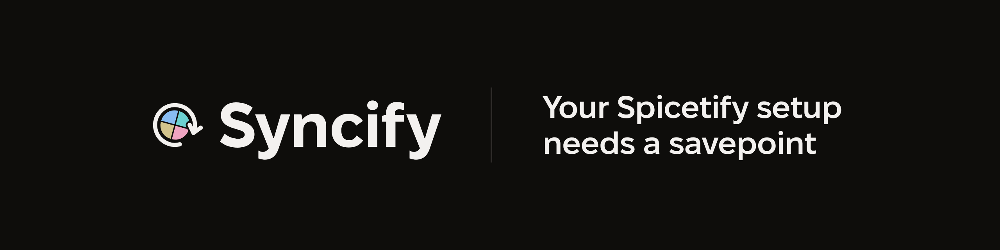

<p align="center">
  
</p>

<p align="center">
  <a href="https://syncify.wsoltani.com"></a>
  <a href="https://syncify.wsoltani.com/discord"></a>
</p>

## Using Syncify

Syncify backs up what you installed from Spicetify Marketplace, so you get it back in one click after a Spotify update or on a new computer.

### Install

**From Marketplace (recommended):** search for **Syncify** and click Install.

**Manually:** put `syncify.js` from the [latest release](https://github.com/wSoltani/Syncify/releases/latest) in your Spicetify `Extensions` folder, then run:

```bash
spicetify config extensions syncify.js
spicetify apply
```

The folder is `%appdata%\spicetify\Extensions\` on Windows and `~/.config/spicetify/Extensions/` on macOS and Linux.

### How to use it

Open Syncify from the top bar, your profile menu, or <kbd>Ctrl</kbd>+<kbd>Alt</kbd>+<kbd>S</kbd>.

- **Back up now** saves your setup
- **Restore** shows what changes before anything happens
- **Back up automatically** backs up when Spotify starts

Syncify keeps your 3 latest backups and a weekly safety copy.

### Share and Discover

- Sign in, then **Share this setup** gives you a code anyone can load
- Paste a code or a link under **Share** to load someone's setup
- [Discover](https://syncify.wsoltani.com/discover) lists setups people posted, and you can post yours there

### Updating

Syncify updates itself when Spotify starts. If it says your version is no longer supported:

- **Marketplace install:** restart Spotify or reinstall Syncify
- **Manual install:** replace `syncify.js` with the [latest release](https://github.com/wSoltani/Syncify/releases/latest) and run `spicetify apply`

### Good to know

- Syncify needs [Spicetify Marketplace](https://github.com/spicetify/marketplace)
- Things you set up manually in Spicetify's config are listed in your backups with the commands to add them back
- You can delete everything any time. [What Syncify stores](https://github.com/wSoltani/Syncify/blob/master/PRIVACY.md)

### Support

If Syncify saved your setup, you can support it on Ko-fi:

[](https://ko-fi.com/wsoltani)

Starring the repo and sharing it help a lot too. 💚

Bug or idea? [Open an issue](https://github.com/wSoltani/Syncify/issues/new) or ask in the [Syncify Discord](https://syncify.wsoltani.com/discord).

Check out [Netherstone](https://github.com/Netherstone-HQ/Netherstone)

---

## Development

This repo is the Spicetify extension; the backend lives in a separate repo.

```bash
npm install          # install dependencies
npm run build        # build dist/ (commit it with your changes; CI checks it)
npm run watch        # rebuild on change
npm run typecheck    # type-check
npm run install:dev  # install a "Syncify (dev)" build into Spicetify (Windows)
```

**Beta channel:** to get releases early, run `localStorage.setItem("syncify:beta", "true")` in Spotify's DevTools (`spicetify enable-devtools`) and restart Spotify. `localStorage.removeItem("syncify:beta")` turns it off.
