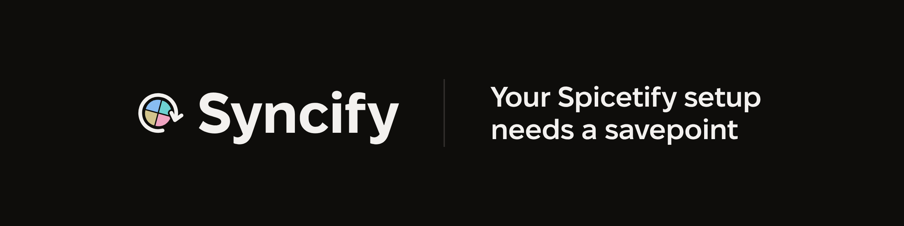

<p align="center">
  
</p>

## Using Syncify

Syncify saves the extensions, themes and snippets you installed from Spicetify Marketplace to the cloud. When a Spotify update breaks things, or you reinstall, or you move to a new computer, you can get all of it back in one click.

There's no account to create. Backups are tied to the Spotify account you're signed in with.

### Install

**From Marketplace (recommended):** open Spicetify Marketplace, search for **Syncify**, and click Install.

**Manually:** download `syncify.js` from the [latest release](https://github.com/wSoltani/Syncify/releases/latest) and put it in your Spicetify `Extensions` folder:

- Windows: `%appdata%\spicetify\Extensions\`
- macOS / Linux: `~/.config/spicetify/Extensions/`

Then run:

```bash
spicetify config extensions syncify.js
spicetify apply
```

### How to use it

Open Syncify from the button in Spotify's top bar, from your profile menu, or with <kbd>Ctrl</kbd>+<kbd>Alt</kbd>+<kbd>S</kbd>.

- **Back up now** saves what you have installed. If nothing has changed since your last backup, there's nothing to save and the button says so.
- **Backups** lists your 3 most recent backups, plus a **safety copy**: an older backup kept aside and updated about once a week, so a burst of new backups can't replace it. The one tagged **Current** matches what's on this device right now. When everything is backed up, only the latest shows; **Show all** lists the rest.
- **Restore** puts a backup back on this device, after showing what it adds and removes and flagging anything that isn't from Marketplace. Spotify then reloads with your setup.
- **Back up automatically** (off by default) backs up when Spotify starts, but only if something changed. It won't overwrite a bigger cloud backup with a smaller or empty setup, so a fresh install can't wipe out your saved one.

You can change the shortcut and where the Syncify button appears under **Settings**, at the bottom of the window.

### Updating

Syncify updates itself. Like other extensions that update themselves, it loads its latest release each time Spotify starts, whether you installed it from Marketplace or manually. When a new version comes out while Spotify is open, the bottom of Syncify's window says so; click **Reload** to switch to it.

Old versions stop backing up after a grace period, and Syncify then says it's no longer supported. If you see that:

- **From Marketplace:** restart Spotify. If it still says so, uninstall Syncify in Marketplace and install it again.
- **Manual install:** download `syncify.js` from the [latest release](https://github.com/wSoltani/Syncify/releases/latest), replace the one in your `Extensions` folder, then run `spicetify apply`. From then on it updates itself.

### Good to know

- Syncify needs [Spicetify Marketplace](https://github.com/spicetify/marketplace) to be installed. It saves Marketplace's list of what you installed, and Marketplace downloads the actual files again after a restore.
- If something shows as installed but doesn't load after a restore, reload Spotify once more or reinstall that item from Marketplace.
- Backups also list the extensions, custom apps and theme you set up manually in Spicetify's config, but Syncify can only restore what came from Marketplace.
- **Privacy:** Syncify never sends your Spotify username. It sends a one-way hash of it, which identifies your backups without revealing who you are. Each request also carries Syncify's version, a random ID for this install, your time zone and which Spotify account field was hashed, so the server knows which versions are in use and can count backups and restores in your local time. Backups are not encrypted on the server, so don't count on them to keep anything secret.

### Support

If Syncify saved your setup, consider supporting the project:

[](https://ko-fi.com/wsoltani)

Starring the repo, sharing it and [reporting bugs](https://github.com/wSoltani/Syncify/issues/new) help a lot too. 💚

---

## Development

This repo is the Spicetify extension. The backend is a Cloudflare Worker that lives in a separate `syncify-worker` repo.

### How it works

- Syncify reads every `marketplace:*` key from `localStorage` and from Marketplace's IndexedDB store (newer Marketplace versions use IndexedDB).
- The keys are hashed so Syncify can tell whether anything changed. The hash skips data Marketplace rewrites on its own, like the active tab, sort order, and star counts.
- Backups are sent to the Worker under a SHA-256 hash of the Spotify user ID. The Worker keeps the 3 latest backups plus an older safety copy. If an upload has the same data as the latest backup, the Worker doesn't store it again.
- Every request carries `x-syncify-version`, `x-syncify-install` (a random ID kept in Syncify's own IndexedDB database, which survives Spotify profile resets) and `x-syncify-timezone`.
- To restore, Syncify writes the keys back to both `localStorage` and IndexedDB, then reloads Spotify.

### Commands

```bash
npm install          # install dependencies
npm run build        # build dist/syncify.js (loader) and dist/syncify.bundle.js
npm run watch        # rebuild on change
npm run typecheck    # type-check only
npm run install:dev  # install a "Syncify (dev)" build into Spicetify (Windows), then run spicetify apply
```

`install:dev` installs the app itself, without the loader, and doesn't touch `dist`.

### Configuration

The Worker URL is baked in at build time:

```bash
SYNCIFY_WORKER_URL=http://localhost:8787 npm run build
```

`SYNCIFY_GITHUB_URL`, `SYNCIFY_KOFI_URL` and `SYNCIFY_ISSUE_URL` override the footer links the same way, and `SYNCIFY_RELEASES_URL` the address of `latest.json`, which the update note reads. At runtime, setting `window.SyncifyConfig` (with `workerUrl`, `githubUrl`, `kofiUrl`, `issueUrl` or `releasesUrl`) before Syncify starts overrides them too.

### How Syncify loads

- `dist/syncify.js` is a small loader. It's the file Marketplace runs (from `master`, through jsDelivr) and the file manual installs download. It rarely changes.
- At startup it reads `latest.json` from `https://syncify-releases.wsoltani.com` (giving up after 3 seconds), then loads that release's `dist/syncify.bundle.js` from jsDelivr by its tag. It accepts only a version number such as `1.4.0` or `1.4.0-beta.1` and always loads from this repo.
- If `latest.json` can't be read, it loads the last version it loaded. If that fails too, it loads `dist/syncify.bundle.js` from `master`.
- If another copy of Syncify is already running, the second one stops.

**Beta channel:** to get releases before everyone else, run this in Spotify's DevTools (`spicetify enable-devtools`), then restart Spotify:

```js
localStorage.setItem("syncify:beta", "true")
```

The loader then loads the newer of `latest-beta.json` and `latest.json`. `localStorage.removeItem("syncify:beta")` goes back to stable releases.

### Releasing

Every release goes to the beta channel first, and reaches everyone only once it's promoted. jsDelivr serves the files committed in each tag, so every release commits a fresh build. Never re-tag: jsDelivr caches a tag's files for a year, so a fix gets a new version.

1. **Beta**, on a release branch, never on `master`:

   ```bash
   npm version 1.4.0-beta.1
   git push --follow-tags
   ```

2. **Stable**, once a beta works: merge the branch, then on `master` re-version the same code, so stable users don't see a beta version:

   ```bash
   npm version 1.4.0
   git push --follow-tags
   ```

3. **Promote:** run the **Promote** workflow in GitHub Actions with `1.4.0`. It writes `latest.json`, which reaches everyone within about a minute. To roll back, run it with the previous version.

`npm version` bumps `package.json` and `manifest.json`, rebuilds `dist`, commits, and tags the result. Pushing a tag runs the Release workflow: it checks that the committed `dist` matches its own build, publishes a GitHub release with the loader attached, then points `latest-beta.json` at the new version (never at an older one). CI fails any push or pull request where `dist` is out of date.
